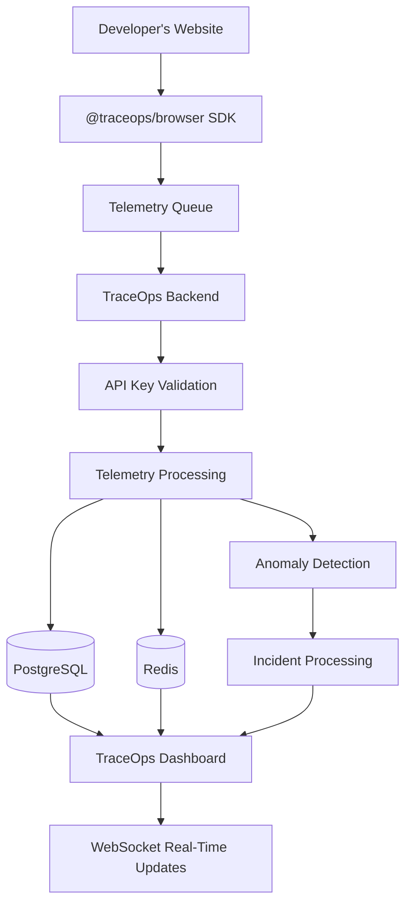

# TraceOps

**A lightweight observability platform for monitoring websites through browser telemetry.**

TraceOps allows developers to connect their existing websites, collect real-time telemetry, monitor browser performance, inspect errors, and investigate application behaviour through a centralized dashboard.

Instead of building monitoring infrastructure from scratch, developers can integrate the TraceOps Browser SDK and start observing their applications.

---

## Overview

Modern web applications generate valuable information about their runtime behaviour: errors, performance bottlenecks, slow operations, and user-facing issues.

TraceOps brings this information together in one dashboard.

Developers can create a project, integrate the Browser SDK into an existing website, and monitor its telemetry through traces, logs, errors, incidents, and Core Web Vitals.

## Features

### Browser Monitoring

- Automatic JavaScript runtime error detection.
- Unhandled promise rejection monitoring.
- Browser performance monitoring.
- Single-page application route tracking.
- Navigation timing collection.
- Core Web Vitals monitoring:
  - Largest Contentful Paint (LCP)
  - Interaction to Next Paint (INP)
  - Cumulative Layout Shift (CLS)
  - First Contentful Paint (FCP)
  - Time to First Byte (TTFB)

### Distributed Tracing

- Capture application spans.
- Trace and span ID generation.
- Span duration and status tracking.
- OTLP-compatible HTTP JSON ingestion.
- Service-level telemetry organization.

### Logging

- Structured log ingestion.
- Log severity levels.
- Trace-correlated logs.
- Error stack trace collection.
- Automatic sensitive-data sanitization.

### Incident Monitoring

- Error and anomaly detection.
- Incident tracking and inspection.
- Incident resolution workflow.
- AI-assisted root cause analysis using Groq, with deterministic fallback when the AI service is unavailable.

### Analytics Dashboard

- Project-specific observability.
- Real-time telemetry updates using WebSockets.
- Trace inspection and waterfall visualization.
- Log exploration.
- Error signature distribution.
- Performance metrics and Core Web Vitals.
- Empty-state onboarding for new projects.

### Multi-User Project Management

- User registration and authentication.
- Project creation.
- Project-specific API keys.
- Project ownership and access isolation.
- Admin-level project access.

---

## Architecture



### Data Flow

1. A developer creates a project in TraceOps.
2. TraceOps generates a project-specific API key.
3. The developer integrates the Browser SDK into their website.
4. The SDK collects browser telemetry and batches events.
5. Telemetry is transmitted to the TraceOps ingestion endpoints.
6. The backend validates the project API key and processes the data.
7. Telemetry is stored in PostgreSQL, with Redis used for relevant counters and processing.
8. The dashboard displays the collected information and receives real-time updates.

---

## Technology Stack

| Layer | Technologies |
|---|---|
| Frontend | Next.js, React, Tailwind CSS |
| Backend | NestJS, Node.js, TypeScript |
| Database | PostgreSQL |
| ORM | Prisma |
| Caching and processing | Redis |
| Real-time communication | WebSockets |
| Browser SDK | TypeScript |
| Telemetry format | OTLP HTTP JSON |
| AI-assisted analysis | Groq API |
| Frontend deployment | Vercel |
| Backend deployment | Render |

---

## Project Structure

```text
TraceOps/
│
├── backend/
│   ├── src/
│   │   ├── auth/
│   │   ├── projects/
│   │   ├── telemetry/
│   │   ├── incidents/
│   │   ├── services/
│   │   └── ...
│   ├── prisma/
│   └── ...
│
├── frontend/
│   ├── app/
│   ├── components/
│   ├── context/
│   ├── lib/
│   └── ...
│
├── browser-sdk/
│   ├── src/
│   │   ├── index.ts
│   │   ├── traceops.ts
│   │   ├── queue.ts
│   │   ├── transport.ts
│   │   ├── sanitizer.ts
│   │   ├── types.ts
│   │   └── utils.ts
│   │
│   ├── test/
│   ├── examples/
│   │   └── demo-website/
│   ├── dist/
│   └── package.json
│
└── README.md
```

*The structure above highlights the main application modules; individual files may vary.*

---

## Getting Started

### Prerequisites

Install the following:

- Node.js 18 or later.
- npm.
- PostgreSQL.
- Redis.

### 1. Clone the repository

```bash
git clone <YOUR_REPOSITORY_URL>
cd TraceOps
```

### 2. Configure the backend

Create a `.env` file inside `backend/`.

Use the following variables as a starting point. Refer to the backend environment configuration for the exact required names and values.

```env
PORT=4000

DATABASE_URL=your_postgresql_connection_string
REDIS_URL=your_redis_connection_string

JWT_SECRET=your_long_random_secret

GROQ_API_KEY=your_groq_api_key
```

Never commit actual credentials or `.env` files.

### 3. Start the backend

```bash
cd backend
npm install
npm run build
npm run start
```

Backend:

`http://localhost:4000`

### 4. Start the frontend

Open another terminal:

```bash
cd frontend
npm install
npm run build
npm run start
```

Dashboard:

`http://localhost:3000`

For development with hot reload, use the existing development scripts instead of the production start commands.

### 5. Build the Browser SDK

Open another terminal:

```bash
cd browser-sdk
npm install
npm run build
```

---

## Connecting Your Website

TraceOps provides a standalone Browser SDK for integrating existing JavaScript and TypeScript websites.

### Step 1: Create a project

1. Open the TraceOps dashboard.
2. Register or log in.
3. Create a new project.
4. Open the project's SDK connection guide.
5. Copy the project API key.

### Step 2: Install the SDK

For local development, build the package and install the generated tarball:

```bash
cd browser-sdk
npm install
npm run build
npm pack
```

Install the generated `.tgz` file in your website:

```bash
npm install ../path-to/traceops-browser-0.1.0.tgz
```

### Step 3: Initialize TraceOps

```typescript
import { TraceOps } from '@traceops/browser';

TraceOps.init({
  apiKey: 'YOUR_PROJECT_API_KEY',
  endpoint: 'http://localhost:4000',
  serviceName: 'my-website',
});
```

Use your deployed backend endpoint when connecting to a deployed TraceOps instance.

### Step 4: Capture custom telemetry

Capture a span:

```typescript
TraceOps.captureSpan({
  name: 'checkout-process',
  durationMs: 120,
  statusCode: 200,
});
```

Capture a log:

```typescript
TraceOps.captureLog({
  message: 'Checkout completed successfully',
  severity: 'INFO',
});
```

### Step 5: Flush and shut down

```typescript
await TraceOps.flush();
```

When your application needs to stop the SDK:

```typescript
await TraceOps.shutdown();
```

The SDK also supports automatic browser monitoring, including JavaScript errors, unhandled promise rejections, navigation performance, and Core Web Vitals.

Refer to the SDK source and types for the complete configuration and API.

---

## Running the Demo Website

TraceOps includes a standalone demo storefront that demonstrates how an ordinary website can integrate the Browser SDK.

### Start the demo

```bash
cd browser-sdk/examples/demo-website
npm install
npm start
```

Open:

`http://localhost:5050`

### Demo workflow

1. Open the TraceOps dashboard at `http://localhost:3000`.
2. Register or log in.
3. Create a project named `Storefront Demo`.
4. Open the SDK connection guide and reveal the project API key.
5. Open the demo website.
6. Enter the API key and connect the SDK.
7. Generate telemetry using the available demo controls.

The demo supports:

- Normal span generation.
- Information log generation.
- Deliberate JavaScript runtime errors.
- Unhandled promise rejections.
- SPA route transitions.
- Manual queue flushing.
- Interactive storefront actions.

Return to the dashboard to inspect the resulting telemetry.

---

## Telemetry Endpoints

The backend exposes the following primary ingestion endpoints:

| Endpoint | Method | Purpose |
|---|---|---|
| `/v1/traces` | POST | Trace and span ingestion |
| `/v1/logs` | POST | Log ingestion |

Telemetry requests authenticate using the project API key through the `x-traceops-key` header.

The backend accepts OTLP HTTP JSON payloads and processes telemetry for the corresponding project.

Project management and dashboard endpoints use authenticated user sessions.

---

## Security and Data Handling

TraceOps implements several basic security measures:

- JWT-based user authentication.
- Password hashing using bcrypt.
- Project ownership checks.
- Project-specific API key validation.
- Protected project management endpoints.
- WebSocket authentication and project access checks.
- Sensitive telemetry attribute redaction.
- Bounded SDK event queues.
- Sanitization of sensitive URL query parameters.

The Browser SDK avoids collecting form contents, passwords, cookies, and authentication tokens.

**Note:** The current frontend keeps JWT sessions in React memory. Refreshing the page requires logging in again. This is an intentional simplification for the project.

---

## Testing and Verification

The final implementation was tested locally.

| Component | Verification | Result |
|---|---|---|
| Browser SDK | Automated tests | 21/21 passed |
| Backend | TypeScript production build | Passed |
| Frontend | Next.js production build | Passed |
| End-to-end integration | Live integration assertions | 10/10 passed |
| CORS | External-origin preflight | HTTP 204 |
| Demo website | HTTP and SDK bundle checks | HTTP 200 |
| Multi-tenant isolation | Unauthorized project access | HTTP 403 |
| Host resilience | Backend unavailable scenario | No unhandled exceptions |

The end-to-end tests covered telemetry ingestion, persistence, project isolation, and SDK behaviour.

### Testing limitations

- Physical Safari and iOS device testing was not performed.
- Cloud-deployed Vercel-to-Render telemetry integration was not included in the final verification.
- Long-running, high-volume anomaly evaluation was not tested.

---

## Known Limitations

- Browser SDK is currently maintained as a local package and has not been published to npm.
- Frontend authentication sessions are in-memory and do not survive page refreshes.
- External telemetry ingestion uses permissive cross-origin access without credentials; project API keys are still validated by the backend.
- Long-duration, high-volume production load testing has not been performed.
- AI-assisted root cause analysis depends on Groq availability; deterministic fallback analysis is available.

---

## Future Improvements

Potential extensions include:

- Publishing the Browser SDK to npm.
- Additional framework-specific integrations.
- More detailed trace filtering and search.
- Historical performance comparisons.
- Custom alert thresholds.
- More advanced anomaly detection.
- Additional telemetry visualizations.

These are potential future enhancements, not claims about existing functionality.

---

## Project Goal

TraceOps was built to explore how a developer-focused observability platform can collect and visualize telemetry from independently developed web applications.

The central idea is simple:

**Connect your website. Collect telemetry. Understand what is happening inside your application.**

---

**Built with TypeScript, Next.js, NestJS, PostgreSQL, Redis and a custom Browser SDK.**